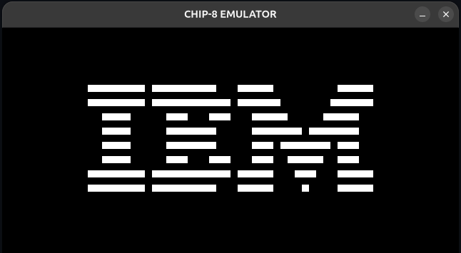
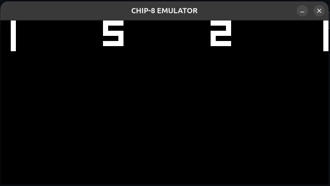

# CHIP-8 Emulator

A CHIP-8 interpreter written in C with SDL2 for graphics and input. It implements all 35 standard CHIP-8 opcodes and has been tested with the Timendus CHIP-8 test suite.

## Screenshots

### IBM Logo

### PONG

## Features

- All 35 standard CHIP-8 opcodes
- 64×32 display, scaled 10× (640×320 window)
- Approximately 700 Hz CPU with separate 60 Hz delay and sound timers
- 16-key hex keypad mapped to the keyboard, including the blocking `FX0A` key wait
- Error detection for invalid or unsupported opcodes, stack overflow and underflow, and out-of-range PC or memory access, reported with the offending instruction and PC
- Tested with the Timendus CHIP-8 test suite and PONG

## Status

| Feature                       | Status  |
|-------------------------------|---------|
| CPU, display, input, timers   | Done    |
| Sound (beep on `sound_timer`) | Planned |
| Debugger (`--debug` mode)     | Planned |

## Building

Requirements: a C compiler (GCC or Clang), `make`, and the SDL2 development library.

Installing SDL2:

- Debian / Ubuntu: `sudo apt install build-essential libsdl2-dev`
- Fedora: `sudo dnf install gcc make SDL2-devel`
- macOS (Homebrew): `brew install sdl2`

Then build with `make`.

## Usage

Run the emulator with `./chip8 path/to/rom.ch8`. Close the window to quit.

### Keypad

The original CHIP-8 hex keypad is mapped to the left side of the keyboard.

| CHIP-8 key | Keyboard | CHIP-8 key | Keyboard |
|---|---|---|---|
| 1 | 1 | 4 | Q |
| 2 | 2 | 5 | W |
| 3 | 3 | 6 | E |
| C | 4 | D | R |
| 7 | A | A | Z |
| 8 | S | 0 | X |
| 9 | D | B | C |
| E | F | F | V |

## ROMs

No ROMs are bundled with this repository. See [`rom/README.md`](rom/README.md) for instructions on downloading test ROMs and games.

The error-handling test ROMs are generated locally with `python tools/rom_maker.py`.

## Testing

The emulator has been tested with the [Timendus CHIP-8 test suite](https://github.com/Timendus/chip8-test-suite):

- [x] 1 - CHIP-8 logo
- [x] 2 - IBM logo
- [x] 3 - Corax+ opcode test
- [x] 4 - Flags
- [x] 5 - Quirks
- [x] 6 - Keypad
- [x] 7 - Beep (sound timer verified; audio output not implemented)
- [ ] 8 - Scrolling (SUPER-CHIP instructions not implemented)

`tools/rom_maker.py` generates ROMs that deliberately trigger each error path: stack overflow, stack underflow, invalid `5XY1`, `9XY1` and `8XY9`, and unsupported `0NNN`. Running any of them shows the emulator reporting the error instead of crashing.

## Project layout

- `src/main.c`: main loop, timing and ROM loading
- `src/chip8.c` and `src/chip8.h`: CPU state, fetch/decode/execute, timers
- `src/display.c` and `src/display.h`: SDL2 window, rendering and keyboard input
- `tools/rom_maker.py`: generates the error-handling test ROMs
- `rom/README.md`: where to get ROMs (none bundled)

## Roadmap

- [ ] Audio: square-wave beep while `sound_timer > 0`
- [ ] Debugger: step through instructions, inspect registers, memory and stack
- [ ] Redraw only when the display changes

## References

- [CHIP-8 Technical Reference](http://devernay.free.fr/hacks/chip8/C8TECH10.HTM) (Cowgod)
- [Timendus CHIP-8 test suite](https://github.com/Timendus/chip8-test-suite)
- [Guide to making a CHIP-8 emulator](https://tobiasvl.github.io/blog/write-a-chip-8-emulator/) (Tobias V. Langhoff)

## License

[MIT](LICENSE) © Atharva Singh